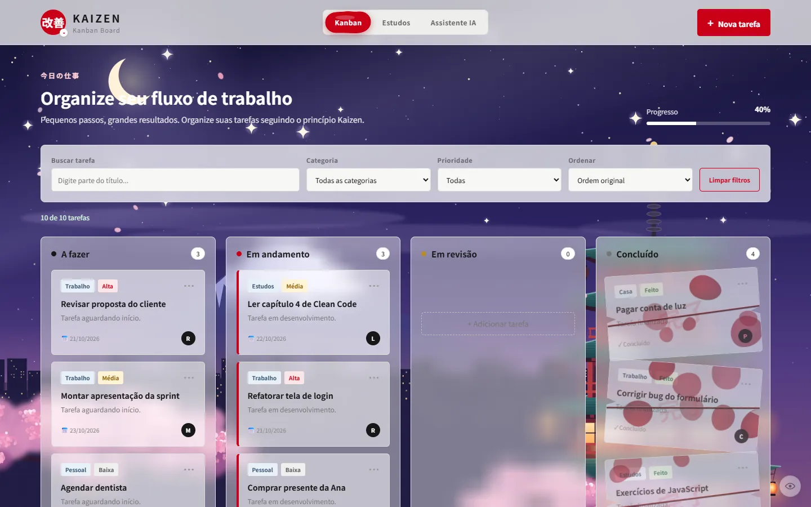
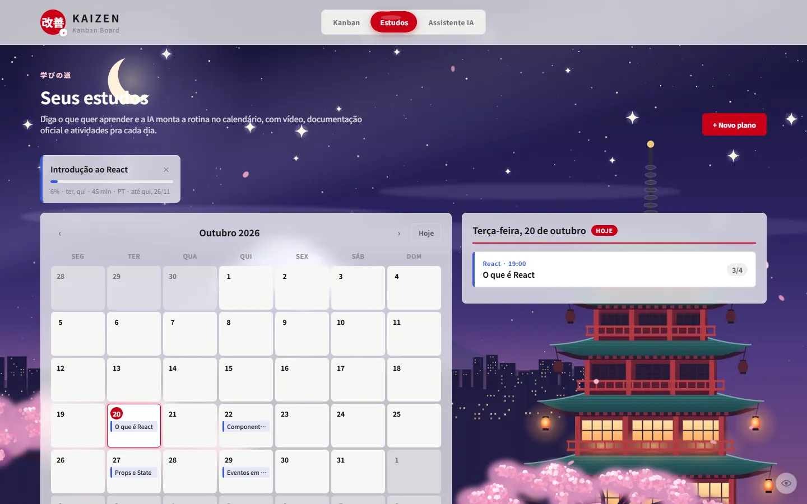
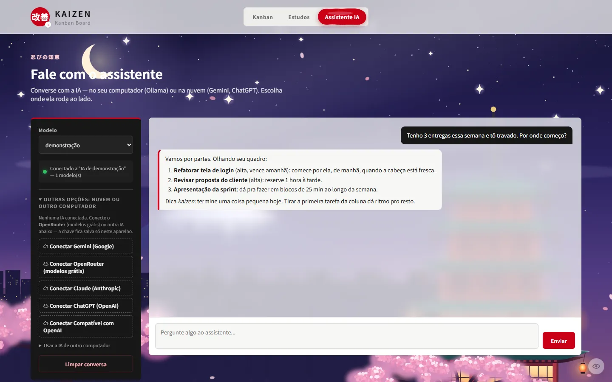

<p align="center">
  
</p>

<h1 align="center">Kaizen</h1>

<p align="center">
  Kanban de tarefas com um assistente que monta sua rotina de estudos.<br>
  <sub>改善 — melhoria contínua, um passo de cada vez.</sub>
</p>

<p align="center">
  <a href="https://github.com/Cabrly/kaizen/releases/latest"></a>
  
  
</p>

<p align="center">
  <a href="https://github.com/Cabrly/kaizen/releases/latest"><b>Baixar</b></a> ·
  <a href="https://cabrly.github.io/kaizen/"><b>Usar no navegador</b></a> ·
  <a href="https://cabrly.github.io/kaizen/?demo"><b>Ver a demonstração</b></a>
</p>

<p align="center">
  
</p>

## Sobre

O Kaizen junta duas coisas: um quadro kanban pra organizar o dia e um assistente
de estudos. Você diz o que quer aprender ("quero estudar React") e a IA monta a
rotina no calendário, com vídeo, documentação oficial e atividades pra cada dia.

A IA pode rodar no seu próprio computador, de graça na nuvem ou pela sua
assinatura do Claude, do Gemini ou do ChatGPT. Não precisa criar conta.

## Funcionalidades

- **Kanban** com categorias, prioridades e prazos
- **Planos de estudo** gerados por IA, com materiais reais (a IA nunca inventa link)
- **Flashcards prontos** do que você estudou nos últimos dias, com revisão espaçada
- **Entregue as atividades** (texto, arquivos ou link do GitHub) e receba **nota e correção** da IA,
  que passa a reforçar os pontos em que você teve dificuldade
- **IA que conhece seu progresso**: explica a partir do que você já estudou
- **Pets de estudo** (opcional): cada plano vira um bichinho que fica feliz quando você estuda
- **Assistente** que conversa olhando suas tarefas
- **Cenas animadas** que evoluem a cada tarefa concluída
- **IA local** ([Ollama](https://ollama.com)) instalada em um clique, ou na nuvem ([OpenRouter](https://openrouter.ai), Claude, ChatGPT, Gemini)
- **Claude Code, Gemini CLI e Codex** usando a assinatura que você já tem
- **A IA do seu PC no celular**, pelo Tailscale, configurada pela tela e com QR Code
- **Sincronia entre PC e celular** por QR Code, com criptografia de ponta a ponta
- **Funciona offline** e instala como app no celular

<table>
  <tr>
    <td></td>
    <td></td>
    <td></td>
  </tr>
</table>

## Como usar

**Programa de computador:** baixe o instalador na
[página de versões](https://github.com/Cabrly/kaizen/releases/latest) e abra.

**Navegador ou celular:** acesse [cabrly.github.io/kaizen](https://cabrly.github.io/kaizen/).
No celular, dá pra adicionar à tela de início e usar como app.

**Pelo código:**

```bash
git clone https://github.com/Cabrly/kaizen.git
cd kaizen
python3 server.py
```

Depois abra `http://localhost:8000`. Precisa só do Python 3.9+, sem dependências.

Configuração da IA, escolha de modelo, sincronia, Docker e como gerar os
instaladores estão no **[guia completo](docs/GUIA.md)**.

## Tecnologias

- **Front-end:** HTML, CSS e JavaScript puro, sem build
- **Back-end:** Python (biblioteca padrão) + SQLite
- **Programa de computador:** [Tauri](https://tauri.app)
- **Sincronia:** Cloudflare Workers + Durable Objects
- **IA:** Ollama, OpenRouter, APIs da Anthropic, OpenAI e Google

## Créditos

Os bichinhos e acessórios 3D dos pets são do [Fluent Emoji](https://github.com/microsoft/fluentui-emoji),
da Microsoft, sob licença MIT ([icones/pets/LICENSE](icones/pets/LICENSE)).

## Apoie

O Kaizen é grátis. Se ele te ajudou, dá pra apoiar com um Pix pelo botão
**Apoiar ♥** no rodapé do app.

---

<p align="center">Feito por <a href="https://github.com/Cabrly">Cabrly</a></p>
